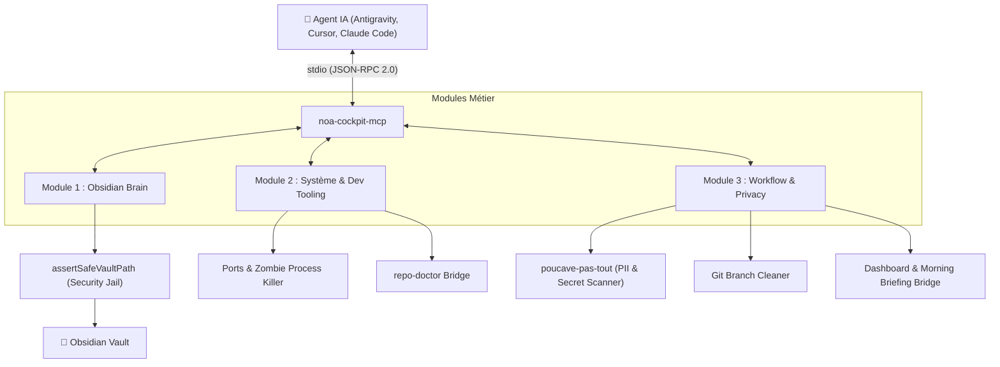

# noa-cockpit-mcp 🎛️

[](https://nodejs.org)
[](https://www.typescriptlang.org)
[](https://modelcontextprotocol.io)
[](tests)
[-success?style=flat-square)](https://github.com/NewGamer62/repo-doctor)
[](LICENSE)

> **Modular Model Context Protocol (MCP) Server connecting AI Agents (Antigravity, Cursor, Claude Code) to Noa's Obsidian Second Brain, Git diagnostics, PII privacy guards, and local developer workflows.**

---

## ⚡ Preview

```json
// JSON-RPC Request (stdio)
{
  "jsonrpc": "2.0",
  "id": 1,
  "method": "tools/call",
  "params": {
    "name": "privacy_guard_scan",
    "arguments": { "repo_path": "." }
  }
}

// JSON-RPC Response
{
  "jsonrpc": "2.0",
  "id": 1,
  "result": {
    "content": [{
      "type": "text",
      "text": "{\n  \"clean\": true,\n  \"repo_path\": \"C:\\\\Users\\\\...\\\\noa-cockpit-mcp\",\n  \"scanned_files_count\": 20,\n  \"violations_count\": 0,\n  \"violations\": []\n}"
    }]
  }
}
```

---

## 🎯 Architecture & Modules

`noa-cockpit-mcp` implémente le standard ouvert **Model Context Protocol (MCP)** en transport `stdio`.  
L'architecture est découpée en **3 modules indépendants** :



### 🛡️ Sécurité & Garde-Fous
1. **Sandbox Vault Jail :** Toute tentative d'accès en dehors du coffre Obsidian (`../../Desktop`, `C:\Windows`, null bytes) est interceptée par une `SecurityError`.
2. **Protection Processus Système :** Le tueur de ports refuse catégoriquement d'interrompre les processus système critiques (PIDs 0 et 4, `svchost.exe`, `explorer.exe`, `csrss.exe`, `services.exe`, etc.).
3. **Anti-Leak PII & Confidentialité :** Le scanner de confidentialité inspecte les chemins machine en dur (`C:\Users\...`), les numéros de téléphone et les fichiers sensibles avant tout commit ou push.

---

## 🛠️ Les 11 Outils MCP Disponibles

### Module 1 : Obsidian Brain (Tranche 1)
| Outil MCP | Description | Paramètres Clés |
| :--- | :--- | :--- |
| `obsidian_search_notes` | Recherche filtrée par texte, tag et pôle thématique | `query`, `tag`, `pole`, `limit` |
| `obsidian_read_note` | Lecture complète avec parsing du Frontmatter YAML | `relative_path` |
| `obsidian_append_journal` | Insertion déterministe d'un bilan quotidien antéchronologique | `date`, `subtitle`, `success_bullets`, `improvements_bullets` |
| `obsidian_add_backlog_task` | Ajout d'une tâche cochable dans Backlog.md par priorité/domaine | `priority (P1/P2/P3)`, `domain`, `task` |
| `obsidian_get_moc` | Extraction des notes liées depuis l'un des 7 Hubs/MOCs | `moc (Index-Projets, Index-Stack, ...)` |

### Module 2 : Système & Dev Tooling (Tranche 2)
| Outil MCP | Description | Paramètres Clés |
| :--- | :--- | :--- |
| `system_inspect_port` | Inspecte le PID et le nom du processus écoutant sur un port TCP | `port (1-65535)` |
| `system_free_port` | Tue le processus occupant un port (avec protection système) | `port`, `force (boolean)` |
| `git_health_audit` | Déclenche un audit de santé complet d'un repo via `repo-doctor` | `repo_path`, `min_score (0-100)` |

### Module 3 : Workflow, Privacy & Git Hygiene (Tranche 3)
| Outil MCP | Description | Paramètres Clés |
| :--- | :--- | :--- |
| `privacy_guard_scan` | Audite un dépôt pour interdire les fuites de chemins machine, PII et secrets (`poucave-pas-tout`) | `repo_path`, `staged_only (boolean)` |
| `git_cleanup_branches` | Détecte et supprime en toute sécurité les branches locales déjà mergées dans master/main | `repo_path`, `dry_run (boolean)`, `base_branch` |
| `dashboard_get_briefing` | Récupère le briefing matinal, les 3 priorités du jour et l'état du serveur local (port 5050) | `custom_dir (optional)` |

---

## 🚀 Démarrage Rapide

### Prérequis
- [Node.js v22+](https://nodejs.org) (Node 24 recommandé).
- `repo-doctor` compilé sur le système (optionnel pour l'audit Git).

### Installation & Compilation
```bash
# Installer les dépendances
npm install

# Compiler le projet TypeScript
npm run build

# Lancer la suite complète de 27 tests unitaires
npm test

# Démarrer le serveur en écoute stdio
npm start
```

---

## 📄 Licence
Sous licence [MIT](LICENSE). Conçu par [Noa (NewGamer62)](https://github.com/NewGamer62).
