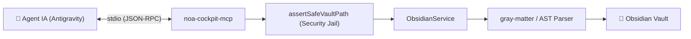

# noa-cockpit-mcp 🎛️

[](https://nodejs.org)
[](https://www.typescriptlang.org)
[](https://modelcontextprotocol.io)
[](tests)
[](LICENSE)

> **Modular Model Context Protocol (MCP) Server connecting AI Agents (Antigravity, Cursor, Claude Code) to Noa's Obsidian Second Brain and local developer workflows.**

---

## ⚡ Preview

```json
// JSON-RPC Request (stdio)
{
  "jsonrpc": "2.0",
  "id": 1,
  "method": "tools/call",
  "params": {
    "name": "obsidian_search_notes",
    "arguments": { "query": "Repo-Doctor", "pole": "01 - Projets" }
  }
}

// JSON-RPC Response
{
  "jsonrpc": "2.0",
  "id": 1,
  "result": {
    "content": [{
      "type": "text",
      "text": "{\n  \"count\": 1,\n  \"results\": [{\n    \"title\": \"Repo-Doctor — Auditeur CLI d'Hygiène & Santé Git\",\n    \"relativePath\": \"01 - Projets/Repo-Doctor.md\",\n    \"tags\": [\"projet\", \"cli\", \"go\", \"portfolio\"]\n  }]\n}"
    }]
  }
}
```

---

## 🎯 Architecture & Piliers

`noa-cockpit-mcp` implémente le standard ouvert **Model Context Protocol (MCP)** en transport `stdio`.  
La **Tranche 1 (Module Obsidian Brain)** élimine les manipulations de fichiers brutes et les regex fragiles en encapsulant le coffre Obsidian de Noa dans une sandbox étanche.



### 🛡️ Sécurité & Isolation (Sandbox Jail)
Toute tentative d'accès en dehors de la racine du coffre (`../../Desktop`, `C:\Windows`, injection d'octets nuls `\0`) est interceptée et bloquée par une exception `SecurityError` avant tout appel disque.

---

## 🛠️ Les 5 Outils MCP Disponibles (Tranche 1)

| Outil MCP | Description | Paramètres Clés |
| :--- | :--- | :--- |
| `obsidian_search_notes` | Recherche filtrée par texte, tag et pôle thématique | `query`, `tag`, `pole`, `limit` |
| `obsidian_read_note` | Lecture complète avec parsing du Frontmatter YAML | `relative_path` |
| `obsidian_append_journal` | Insertion déterministe d'un bilan quotidien antéchronologique | `date`, `subtitle`, `success_bullets`, `improvements_bullets` |
| `obsidian_add_backlog_task` | Ajout d'une tâche cochable dans Backlog.md par priorité/domaine | `priority (P1/P2/P3)`, `domain`, `task` |
| `obsidian_get_moc` | Extraction des notes liées depuis l'un des 7 Hubs/MOCs | `moc (Index-Projets, Index-Stack, ...)` |

---

## 🚀 Démarrage Rapide

### Prérequis
- [Node.js v22+](https://nodejs.org) (recommandé Node 24).

### Installation & Compilation
```bash
# Installer les dépendances
npm install

# Compiler le projet TypeScript
npm run build

# Lancer la suite de tests unitaires (Node natif)
npm test

# Démarrer le serveur en écoute stdio
npm start
```

---

## 🧪 Tests Unitaires
Le projet utilise le test runner natif de Node 24 avec exécution TypeScript via `tsx` :
- `tests/security.test.ts` : 5 tests validant l'imperméabilité de la sandbox et le blocage des path traversals.
- `tests/obsidian.test.ts` : 6 tests validant la recherche, le parsing, l'insertion dans le journal et le backlog sur coffre temporaire.

```bash
npm test
# Output: 11 tests passed in ~220ms
```

---

## 📄 Licence
Sous licence [MIT](LICENSE). Conçu par [Noa (NewGamer62)](https://github.com/NewGamer62).
